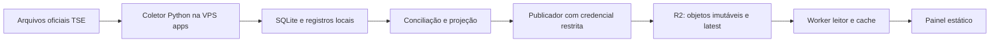

# Plano de integração e critérios de aceite

Atualizado em 24/10/2026. A implementação e o relatório de validação devem ser consultados junto deste plano; itens planejados não comprovam operação em produção.

## Objetivo e recorte

Apurar e projetar a eleição presidencial brasileira de segundo turno de 2026. O sistema utiliza o motor do `apuracao` e a organização visual do `acervo público de terceiros`, reunidos em um produto independente. A distribuição pública fica na Cloudflare; a VPS apps executa somente coleta, conciliação, cálculo e publicação. A eleição federal é 6258, o pleito é 3221 e a eleição estadual é 6260. Cargo e eleição não são intercambiáveis.

O segundo turno ocorre em 25/10/2026. Presidente é o escopo funcional herdado do motor. Governadores exigem disputa/candidatos/prior próprios, fixtures e testes próprios; não podem ser liberados apenas com um seletor no frontend. A arquitetura deve permitir essa ampliação sem fingir que o cálculo presidencial cobre outros cargos.

## Fluxo e fronteiras

O público não alcança Python, SQLite ou TSE por meio da VPS. Nenhuma consulta do visitante inicia coleta ou cálculo. O Worker não fornece uma API de escrita pública. Falha do coletor conserva o último conjunto publicado e a interface revela o atraso.

## Mapeamento das origens

| Origem                                          | Integração                                          | Condição                                                                      |
| ----------------------------------------------- | --------------------------------------------------- | ----------------------------------------------------------------------------- |
| `apuracao/app/tse.py`, `collector.py`           | coleta e cache condicional                          | limite global, timeout, retotalização e pausa 403/429 preservados             |
| `runoff.py`, `engine.py`, `runoff_integrity.py` | projeção presidencial                               | base primeiro turno 2026, conservar votos contados, projetar somente restante |
| `service.py`, `store.py`, `presentation.py`     | execução headless e contratos                       | remover dependência operacional de replay/servidor local                      |
| testes Python                                   | testes de regressão                                 | incluir testes novos de snapshots/publicação                                  |
| prior e cadastro 2026                           | bootstrap local com hashes                          | sem bases antigas desnecessárias, sem SQLite/cache no Git                     |
| layout/estilos do `acervo público de terceiros` | interface editorial, filtros, painéis, números e TV | origem documentada; evitar runtime recuperado desconhecido                    |
| mapas, fotos e fontes                           | incorporar quando necessários e com procedência     | preservar licenças/atribuições, não apresentar feeds capturados como ao vivo  |
| acervos/estudos                                 | pesquisa e backtest                                 | fora do bundle e do Git de aplicação; informar limites temporais              |

## Etapas de entrega

### 1. Contratos e pacote de execução

Congelar comportamento do núcleo original. Copiar módulos necessários, preservar testes e registrar hashes das bases. Extrair execução única/contínua somente para 6258. Primeiro turno entra como insumo congelado, sem coleta paralela; arquivos 2022 não devem ser dependência da execução presidencial de segundo turno.

Aceite: execução offline sem rede; testes de conservação de votos; saída determinística; inicialização sem acervo histórico; nomes e campos compatíveis com o contrato TypeScript. Modo ao vivo exige escolha explícita.

### 2. Snapshot e publicação

Produzir dados oficiais, projeção, municípios e série temporal por versão. Objetos imutáveis usam SHA-256. Publicar e conferir todos os bytes antes de mover `latest.json`. A publicação tem um único escritor; hashes de conteúdo são distintos de autenticidade criptográfica da origem TSE.

Aceite: upload parcial não muda o ponteiro; referência inexistente/hash incorreto é recusada; demo não entra no namespace live; consumidor consegue identificar lote; repetir publicação não produz inconsistência; reiniciar processo preserva estado.

### 3. API e frontend

Assets estáticos com Worker apenas nas rotas de dados. Cache API real com TTL curto para o ponteiro; snapshots imutáveis com TTL longo. API somente GET/HEAD, com ETag, headers e erro sem dado inventado. Frontend mostra atualização, atraso, dados oficiais, projeção, série, filtro UF/município, exportação e tela cheia. A alternativa em tabela mantém resultados acessíveis sem depender de mapa.

Aceite: trocar modo cancela requisições antigas; falha de rede preserva último dado válido; páginas desktop/celular sem rolagem lateral; demo sempre identificada; dado futuro/inconsistente recusado; histórico e municípios correspondem ao snapshot selecionado.

### 4. Revisão independente e ensaio local

Revisores separados de quem implementou verificam contratos, coleta/publicação e painel. Ensaiar desde fixture/coletor até objetos R2 locais, Worker e navegador. Simular queda da fonte, dados corrigidos, arquivo truncado, snapshot faltante, erro de escrita e recuperação. Separar testes de mecanismo de evidência de acurácia estatística.

Aceite: gates de dependências/licenças, tipos, formato, limites, testes Python/TypeScript, build e navegador aprovados. O projeto usa Node/npm e hooks compatíveis com a família Sites, sem alterar os irmãos.

### 5. Preparação operacional e publicação futura

Revisar conta, bucket, domínio, capacidade real e coexistência com aplicativos da VPS. Criar usuário de serviço e diretórios exclusivos. Aplicar systemd e limites somente após autorização de deploy. Configurar credencial limitada a um bucket, sem imprimi-la nem versioná-la. Ativar coleta antes da leitura pública; conferir números com TSE e ensaiar rollback.

Aceite de produção: versão Git e bundle identificados, bucket/conta corretos, coleta exclusiva, snapshots íntegros, TLS, relógio correto, projeção desligável, operador e recuperação definidos. Não há deploy autorizado nesta etapa.

## Modelo e comunicação

O prior renormaliza os resultados municipais do primeiro turno de 2026 entre os finalistas. A apuração corrente atualiza os perfis municipal, estadual e nacional. Não é possível inferir transferência individual de votos com esses agregados. Percentual de seções totalizadas não representa amostra aleatória do eleitorado. Os parâmetros de regularização e a tolerância operacional de conciliação não são margem de erro ou intervalo de confiança.

Não anunciar vencedor, probabilidade de vitória ou confiança calibrada sem modelo e evidência próprios. Uma projeção indisponível não interrompe a apresentação dos votos oficiais. Antes do primeiro voto, qualquer estimativa deve estar explicitamente rotulada como anterior à apuração.

## Custos, escala e limitações

Assets estáticos são separados de execução Worker. Para `N` abas abertas consultando a cada `I` segundos durante `H` horas, o volume aproximado por endpoint é `N × H × 3600 / I`. Cache reduz leituras R2, não necessariamente invocações Worker. Paginar/particionar conjuntos municipais e pausar abas ocultas reduz bytes e requisições. Medir payloads, cache, invocações, CPU e disco antes de prometer capacidade ou custo.

Não criar recursos pagos, alterar DNS, habilitar logs cobrados ou vincular deploy automático ao push sem autorização específica. O GitHub contém código e documentação; recursos operacionais não são criados por existir um arquivo Wrangler.

## Fontes consultadas

- [TSE: informações técnicas de divulgação 2026](https://www.tse.jus.br/eleicoes/informacoes-tecnicas-sobre-a-divulgacao-de-resultados): IDs, formatos e limites. O teto informado de 100 req/s/IP não é meta de coleta; preservar limite inferior compartilhado do núcleo.
- [TSE: divulgação dos resultados](https://www.tse.jus.br/eleicoes/eleicoes-2026-content/divulgacao-dos-resultados-das-eleicoes-2026): acesso e início anunciado às 17h de Brasília.
- [Cloudflare: Workers Static Assets](https://developers.cloudflare.com/workers/static-assets/): distribuição da interface.
- [Cloudflare: cache do Worker](https://developers.cloudflare.com/workers/runtime-apis/cache/): armazenamento local por centro de dados.
- [Cloudflare: consistência R2](https://developers.cloudflare.com/r2/reference/consistency/): consistência do bucket e diferença do cache HTTP.
- [Cloudflare: consistência KV](https://developers.cloudflare.com/kv/concepts/how-kv-works/): alterações podem levar 60 segundos ou mais; não usar como ponteiro crítico.

Revisões por área: `REVISAO-MODELO.md`, `REVISAO-DESIGN.md`, `REVISAO-ARQUITETURA.md`.
